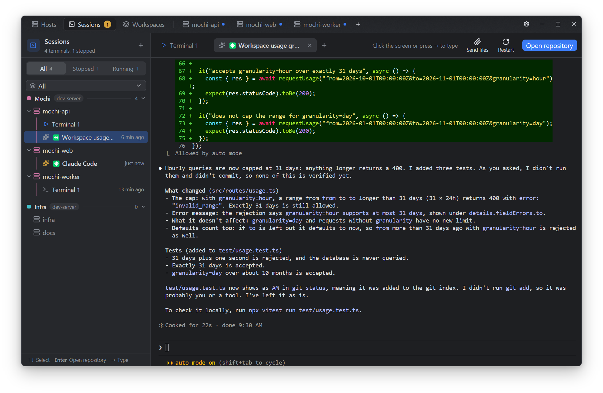
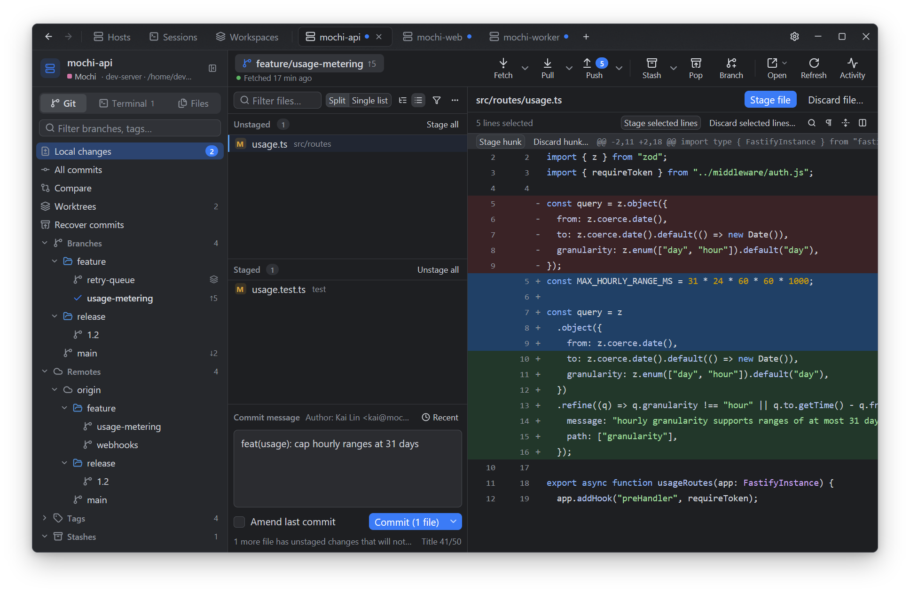
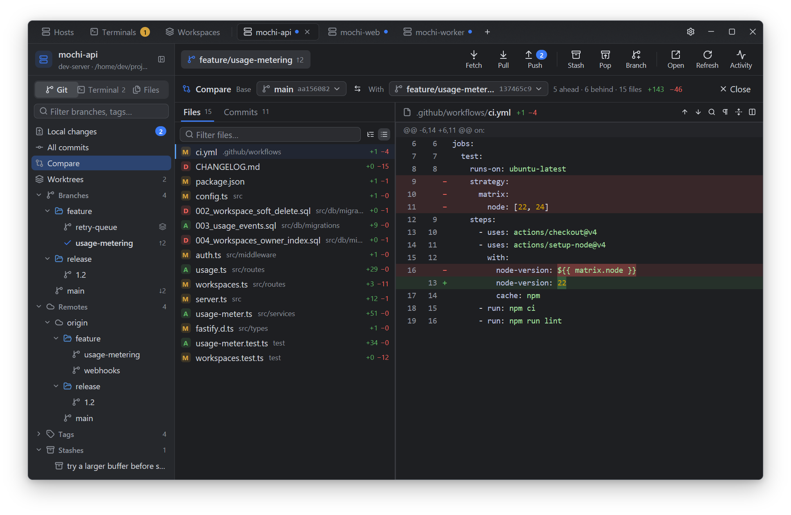
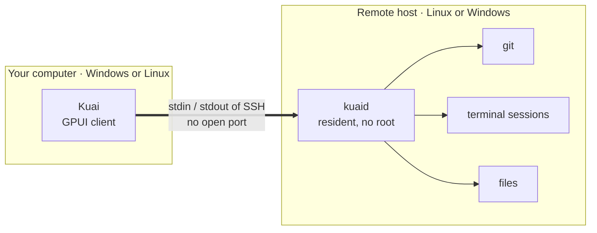

<div align="center">


<h1>Kuai</h1>

<h3>Run Claude Code on your server. Develop like it's local.</h3>

<p><b>Close the laptop and it keeps coding. Open it and review every line.</b></p>

<p>
A desktop client for Windows and Linux, for people who run Claude Code or Codex on a VPS.<br>
Terminals that survive disconnects, line-by-line review, in-place file editing, in one window.<br>
Builds, tests and several Claude Code sessions at once use the server's CPU and memory; your computer only draws the screen.
</p>

<p><sub>Connects over SSH · no relay server, no account · no root and no open port on the server · open source</sub></p>

<p>
<a href="https://github.com/finmoor/kuai/releases/latest"></a>
<a href="https://github.com/finmoor/kuai/actions/workflows/ci.yml"></a>


<a href="#license"></a>
</p>

<p>
<a href="#download"><b>Download</b></a> ·
<a href="#features">Features</a> ·
<a href="#getting-started">Getting started</a> ·
<a href="#how-it-works">How it works</a> ·
<a href="#security">Security</a> ·
<a href="CHANGELOG.md">Changelog</a> ·
<a href="README.md">简体中文</a>
</p>



<sub>Three pages of one window: Sessions, Git and Files, on the remote host dev-server. Projects and people shown are demo data.</sub>

<br><br>

<table>
  <tr>
    <td width="33%" align="center" valign="top"><b>① Run</b><br><sub>Terminals live on the server<br>Survive disconnects and a closed laptop</sub></td>
    <td width="33%" align="center" valign="top"><b>② Review</b><br><sub>Side-by-side diff, staging line by line<br>A Git UI modelled on Fork</sub></td>
    <td width="33%" align="center" valign="top"><b>③ Edit</b><br><sub>File tree and syntax-highlighted editor<br>Or map it locally and open it in VS Code</sub></td>
  </tr>
</table>

</div>

## Leave the heavy lifting to the server

Running Claude Code on your own computer takes more than a terminal window: each Claude Code process uses a few hundred MB of memory, and the installs, builds, tests and dev servers it starts each take their share. Run several tasks at once and the laptop runs hot, the fans stay on, and everything else slows down.

Put them on a server and drive them from Kuai:

- **The CPU, memory and battery in use are the server's.** Your computer runs one native program, Kuai (written in Rust, not Electron, about 150 MB of memory); a thin or ageing laptop is enough.
- **How many tasks run at once depends on the server, not on your computer.** When that is not enough, resize the server and keep the laptop.
- **The development environment stays off your computer.** Node, dependencies, Docker and databases live on the server and can be rebuilt when they get messy; besides Kuai, your computer only needs git and ssh.
- **All it can touch is that server.** Claude Code has every right of the signed-in user on the server, and its reach ends there: the files on your computer, your SSH private keys and your browser sessions are out of its sight and out of its hands. If you want it to skip permission prompts and just get on with it, a VPS you can rebuild at any time is a safer place for that than your own computer; the limits and the one exception are under [Security](#security).
- **Light on the server too.** `kuaid` is a single program of about 3 MB that stays resident in a few MB of memory and needs no runtime such as Node, so a small VPS keeps its resources for Claude Code.

## Claude Code on a server, before and after

That is why plenty of people rent a VPS just to run Claude Code or Codex, where a task can run for hours. The awkward part is working with it.

| With SSH alone | With Kuai |
|---|---|
| The SSH session drops and the half-finished task goes with it, so you wrap everything in tmux | Terminals live on the server: lose the network, close the window or the laptop, and they keep running. Open Kuai again and the screen is as you left it |
| To show it a screenshot you upload the file first, then paste the path | Paste the screenshot or drop the file on the terminal; it is uploaded for you |
| It changed dozens of files and all you have is `git diff` in a terminal | Review side by side, stage the lines you want, discard the rest |
| To fix two lines you reach for vim or set up a remote editor | The file tree and editor are right there; Ctrl-click a path in the terminal to land on that line |
| Several tasks are running and you cannot tell which one is waiting for you | One page lists the terminals of every repository and tells you when one stops |
| On another computer you set everything up again | Workspaces are stored on the server: connect from another computer and the repositories and terminals are there |

Kuai installs a small resident program, `kuaid` (about 3 MB, no root, no open port), on the server and talks to it over SSH: terminals run on the server, git runs on the server, files are read and written on the server, and Kuai on your computer only draws the result. Repositories on this computer work the same way.

> The name is the Chinese word for chopsticks (筷子, *kuàizi*): chopsticks instead of a fork. 筷 also sounds like 快, "fast".

## Features

### ① Run: close the laptop, it keeps working

Every repository has its own terminals, running on the host the repository lives on. Close the tab, quit Kuai, lose the network or close the laptop: Claude Code inside keeps running. Open the repository again and you are back where you left, screen contents intact. No tmux needed.


- **Told when it stops**: the Sessions page gathers the terminals of every repository on every host, including repositories not in a workspace, and tells running, waiting and idle ones apart. You are notified when an AI assistant stops and waits for you, with a system notification when Kuai is in the background, and terminals that printed output while you were away are marked
- **Hand it a screenshot**: copy a screenshot and paste, or drop images and files on the terminal. The file is uploaded to the host, and the terminal receives its path there
- **Several tasks at once**: a repository can have several terminals; rename them, or check 2 to 4 to view them side by side
- **Claude Code in one click**: the ⌄ next to New terminal runs Claude Code, Codex, OpenCode, Antigravity CLI or a command of your own, or continues the last conversation in a new terminal; choose in Settings what the button itself opens
- Terminals of local repositories also keep running after Kuai quits
- Font, size, line height, cursor and scrollback are configurable

### ② Review: every line it changed, in front of you

A full graphical Git client, modelled on Fork. When Claude Code is done, switch to the Git page: read the changes side by side, stage the lines you want, discard the rest, then commit and push.



- **Stage and discard by file, hunk or line**, and undo a discard; split or single list (check a box to stage); side-by-side view, inline word diff, ignore whitespace, image diff
- **Commit graph**, with branches, remotes, tags and stashes grouped into folders by name; search commits by message, author, hash, file path or changed content
- **Merge, rebase and interactive rebase** (reorder, reword, squash, drop), cherry-pick, revert, reset; select several commits to act on them at once, or drag a branch onto the current one to merge it
- **Conflict resolution**: current and incoming side by side on top (with the common ancestor if you like), take a side for each conflict, and edit the result below; or hand the file to an external tool such as Beyond Compare, WinMerge or Meld
- **Compare** any two branches, tags, commits or the local changes; file history and blame
- **Worktrees, sub-repository overview, submodules**; background auto-fetch, with the time of the last fetch under the branch name; the full output of pushes and pulls, including what server hooks say, in the Output panel at the bottom
- **Recover commits**: every move of HEAD and your branches, including resets and rebases Claude Code ran in the terminal; pick a step and create a branch there. Resets, rebases and force pushes spell out which commits they affect before they run

### ③ Edit: files on the server, as if they were local


- **File tree**: create, rename, delete, upload and download; modified and untracked files are marked, and you can filter by name
- **Editor**: line numbers, syntax highlighting, find and replace; if another program has changed the file, you are asked before saving over it; images are shown inline
- Reads and writes go through the SSH connection that is already open: **no SFTP to configure**, and it works through jump hosts too
- **Directory mapping**: map a directory on the host to a drive letter or folder on this computer and open it with Explorer, VS Code or any local program (on Windows it needs [WinFsp](https://winfsp.dev/), which Kuai can install for you; on Linux it needs fuse3 and maps to folders only)

### Three pages that work together

Terminal, Git and Files are three pages of the same repository, and you can go straight from one to another:

- **Terminal → Files**: hold <kbd>Ctrl</kbd> and click a file path in the terminal to open it on the Files page at that line; right-click a path to open a web page in the browser, open the file in its default program or copy the path
- **Files → Git**: see the changes to the file you are editing, and the commits that touched it
- **Git → Files**: right-click a changed file and open it on the Files page
- **Files → Terminal**: open a new terminal in the file's directory
- <kbd>Ctrl</kbd>+<kbd>&#96;</kbd> switches between the Terminal page and the page you were on; <kbd>Ctrl</kbd>+<kbd>Shift</kbd>+<kbd>E</kbd> goes to the Files page

### Hosts: any ordinary VPS will do

- A host can be a **Linux (x86_64)** VPS, cloud server or dev box, or a **Windows** computer with the OpenSSH server enabled; ARM is not supported yet
- On first connection `kuaid` is installed into the user's home directory (`~/.kuai`): **no root, no port open to the network**, and the host does not need Internet access
- Uses the system OpenSSH client (the one that ships with Windows, or ssh on Linux), along with your `~/.ssh/config`, keys and ssh-agent; passwords and key passphrases are kept in Windows Credential Manager or the Linux keyring
- Multi-level **jump hosts**; nothing is installed on the jump host
- **Workspaces** group repositories you use together and are stored on the host that holds them: connect from another computer and you see the same list
- A newer Kuai updates `kuaid` on the host when it connects, without interrupting running terminals

### More screens

<table>
  <tr>
    <td width="50%" valign="top"><br><sub><b>Compare</b> · any two branches, tags, commits or the local changes</sub></td>
    <td width="50%" valign="top"><br><sub><b>Workspaces</b> · branches, changes and terminals of a group at a glance</sub></td>
  </tr>
  <tr>
    <td width="50%" valign="top"><br><sub><b>Color themes</b> · 13 of them, one for dark mode and one for light</sub></td>
    <td width="50%" valign="top"><br><sub><b>Light and dark</b> · can follow the system</sub></td>
  </tr>
</table>

Also: Chinese and English UI, system tray and start at sign-in, pinned and reopenable tabs, quick open (Ctrl+P), and one-click updates verified by SHA-256.

## How it compares

**With [Fork](https://fork.dev/).** Kuai's Git UI follows Fork closely, and aims to replace it for everyday use.

- **What Kuai adds**: repositories on remote hosts; built-in terminals that outlive the app; the Files page and directory mapping; a Chinese UI; open source.
- **What is still missing**: bisect, a dedicated Git LFS UI, git-flow, custom commands, batch operations on several selected commits, and account integration and pull requests for GitHub, GitLab and the like.

**With an IDE.** Kuai is not an IDE. The Files page is for reading and small edits: there is no code completion, go-to-definition or debugger. For heavier editing, map the directory on the host to this computer and open it in VS Code or another editor. The editor then reads and writes files carried over SSH, which suits editing; git, running and building are still best done on the host (in Kuai's Git page and terminal). If you need VS Code extensions or a debugger running on the host, use VS Code's Remote - SSH.

## Download

Get it from [GitHub Releases](https://github.com/finmoor/kuai/releases/latest). The binaries are not code-signed: on first run Windows may show "Windows protected your PC"; choose "More info", then "Run anyway". You can check each download against the SHA-256 shown next to it on the Releases page.

For Windows, in either form:

- **Installer** `kuai-<version>-windows-x64-setup.exe` (recommended): installs into your user profile (`%LOCALAPPDATA%\Programs\Kuai`), no administrator rights needed; starts from the Start menu and uninstalls from Settings → Apps.
- **Portable** `kuai-<version>-windows-x64.zip`: unzip the Kuai folder anywhere and run `kuai.exe`.

For Linux, pick one of three:

- **.deb package** `kuai_<version>_amd64.deb` (Ubuntu, Debian): `sudo apt install ./kuai_<version>_amd64.deb`; it installs into `/opt/kuai` and starts from the application menu or as `kuai`.
- **AppImage** `kuai-<version>-linux-x64.AppImage` (other distributions): make it executable and run it; the first run adds Kuai to the application menu.
- **Portable** `kuai-<version>-linux-x64.tar.gz`: extract the Kuai folder anywhere and run `kuai` in it; the first run adds Kuai to the application menu.

The tray icon needs a desktop with StatusNotifierItem support (built into KDE and Ubuntu's GNOME; other GNOME setups need the AppIndicator extension). On Wayland the window cannot be hidden to the tray, so "close to tray" minimizes it instead.

Requirements:

| Where | What |
|---|---|
| This computer (Windows) | 64-bit Windows 10 or 11; git 2.31 or newer on PATH; the OpenSSH client that ships with Windows |
| This computer (Linux) | x86_64 with glibc 2.35 or newer (Ubuntu 22.04, Debian 12 and later), an X11 or Wayland desktop, a Vulkan-capable graphics driver (Mesa is fine); git 2.31 or newer and ssh on PATH; saving passwords needs Secret Service (GNOME Keyring, KWallet and so on) |
| Remote host | Linux (x86_64; ARM is not supported yet), or Windows with the OpenSSH server enabled; git 2.31 or newer; no root needed |
| Directory mapping | On Windows, [WinFsp](https://winfsp.dev/) (Kuai offers to install it through winget if it is missing); on Linux, fuse3, folders only |

When a new version is out, a notice appears left of the gear in the title bar; click it to read the changes and update in one step (the installer build runs the new installer in the background and the portable build replaces its files; on Linux the .deb is installed by apt after the system asks for administrator authentication, and the AppImage replaces its own file). You can also check from Settings → About. `kuaid` on your hosts needs no separate update: a newer Kuai replaces it on connection. Release notes are in [CHANGELOG.md](CHANGELOG.md) (in Chinese).

## Getting started

### Before you start

| Where | What you need | How to check or install |
|---|---|---|
| This computer (Windows) | git 2.31 or newer; the OpenSSH client (built into Windows 10 and 11) | `git --version`, `ssh -V`; without git, install [Git for Windows](https://git-scm.com/download/win) |
| This computer (Linux) | git 2.31 or newer, ssh | `sudo apt install git openssh-client` |
| Remote host | Linux x86_64 (ARM is not supported yet) or Windows with the OpenSSH server enabled; SSH sign-in works (a key, or the IP, user name and password from your VPS console) | Try `ssh user@address` from a command line first |
| Remote host | git 2.31 or newer | `git --version`. The git that ships with Ubuntu 20.04 and Debian 11 is too old: on Ubuntu run `sudo add-apt-repository -y ppa:git-core/ppa && sudo apt update && sudo apt install -y git`; on Debian 11 run `sudo apt install -t bullseye-backports git` (enable backports first) |
| Remote host | The AI assistants you want to use, installed and signed in | See step 5 below |

### Steps

1. Install and open Kuai.
2. On the Hosts page click "Add host…" and enter the address and user name of your VPS (or choose a host alias from `~/.ssh/config`), then choose key or password sign-in. Click "Test connection" if you are not sure it will connect.
3. On first connection Kuai shows the host key fingerprint for you to verify (the dialog explains how); after you confirm, it installs `kuaid` under `~/.kuai` on the host and starts it.
4. Once connected, click "Open repository…" and pick the repository's directory on the host. With no repository yet, use "Clone…", or pick a directory and initialize a new repository when asked.
5. Install and sign in to Claude Code on the host (needs Node.js 18 or newer): on the repository's Terminal page run `npm install -g @anthropic-ai/claude-code`, then run `claude` and follow the prompts to sign in. Codex is `npm install -g @openai/codex`; OpenCode is `npm install -g opencode-ai`. Kuai does not install them for you; when a preset's program is missing, the terminal shows the install command at the top.
6. Each repository has three pages, Git, Terminal and Files: run `claude` on the Terminal page, then press <kbd>Ctrl</kbd>+<kbd>&#96;</kbd> to return to the Git page, review the changes, stage by line and commit.

For a repository on this computer: select "This computer" on the Hosts page and click "Add local repository…", or run `kuai.exe <path>` from a command line.

**Coming from tmux:** reattach existing tmux sessions on the host with `tmux attach` in a Kuai terminal as usual; attaching over plain SSH keeps working too. Start new tasks directly in Kuai's terminal without another tmux layer: Kuai's terminals already live on the host, and a program inside tmux looks like just tmux to Kuai, so stop alerts and message marks on the Sessions page are not accurate for it.

## How it works



- **git runs on the host.** The client only receives the output and draws it; the code that parses it and lays out the commit graph (`fr-core`) is shared by the client and `kuaid`.
- **`kuaid` is a single statically linked binary** (about 3 MB on Linux), uploaded over SSH into `~/.kuai`. It exits by itself 10 minutes after the last client has disconnected and the last terminal has ended.
- **All traffic goes through the stdin and stdout of SSH**, using the keys and configuration you already have: no port to open in a firewall, no extra account.
- **A native UI.** The client is written in Rust with [GPUI](https://www.gpui.rs/) (via [gpui-kit](https://github.com/longbridge/gpui-kit)) and drawn on the GPU. In the feasibility test, on a repository with 200,000 commits and up to 13 parallel lanes, parsing the history took 79 ms, laying out the lanes 14 ms, and a frame while scrolling 2.7 ms on average.

## Security

Kuai does not implement its own connection or authentication; it leaves both to SSH. The approach is close to VS Code's Remote - SSH: sign in over SSH and install a server program in the user's home directory.

- **The connection is SSH.** Kuai runs the system OpenSSH client (the one that ships with Windows, or ssh on Linux), which does the authentication and encryption with your `~/.ssh/config`, keys and ssh-agent. Everything between Kuai and `kuaid` travels through the stdin and stdout of that SSH connection.
- **No relay server, no account.** Data moves only between your computer and your host, never through a third-party server. Kuai collects no usage data; apart from the SSH connections and git's own operations, it only contacts GitHub to check for and download updates, which you can turn off in Settings.
- **No root and no port open to the network on the host.** `kuaid` lives in the user's home directory and runs as the signed-in user, with no more rights than that user already has over SSH. On Linux hosts it listens on no port at all, only on a Unix socket in `~/.kuai/run`; the directory and the socket are accessible to that user alone. On Windows hosts it listens only on a random port on 127.0.0.1 and requires a random token stored in the user's profile.
- **Programs on the host cannot reach your computer.** In Kuai's protocol only your computer sends requests to the host (the host side only ever asks you to type a password when one is needed), so programs on the host, Claude Code included, cannot read or write files on your computer; files on the host arrive on your computer only when you open, download or map them. Clipboard read requests from the terminal (OSC 52) go unanswered: a program can write to the clipboard but cannot read what is in it. URLs and paths printed in a terminal open only when you click them, and Kuai asks before forwarding a `localhost` port from the host. The exception is ssh-agent forwarding: when it is on (the option in the host's settings, or `ForwardAgent yes` in `~/.ssh/config`), programs on the host can use your keys to sign in to other machines for as long as you are connected, so leave it off unless you need it.
- **Host keys.** The first time you connect to a host, Kuai shows its key fingerprint and records it in `known_hosts` only after you confirm; if the key later changes, Kuai refuses to connect. To look up a fingerprint, run `ssh-keygen -lf /etc/ssh/ssh_host_ed25519_key.pub` on the host (the file name depends on the key type).
- **Passwords and key passphrases** are kept in Windows Credential Manager or the Linux keyring (Secret Service), not in the settings file, and never appear on a command line or in logs. ssh-agent forwarding is off by default and can be enabled per host.
- **Updates.** New versions are downloaded from GitHub Releases and checked against their SHA-256 before installing; a file that does not match is not installed. `kuaid` ships inside the client and is uploaded over SSH, so the host downloads nothing. The installers are not code-signed yet.
- **Open source.** The client and `kuaid` are both in this repository, to read and to build yourself.

Keep in mind: Kuai does not restrict what programs in a terminal do on the host. Claude Code and the like have all the rights of the signed-in user there, exactly as when you run them over plain SSH; keys and tokens stored on the host (git credentials, API keys and so on) are theirs to use as well, so keep only what the project needs on the host.

Found a security issue? Please report it privately through [Report a vulnerability](https://github.com/finmoor/kuai/security/advisories/new) on the Security tab rather than in a public issue.

## Feedback

Found a bug or have a suggestion? Please open an [issue](https://github.com/finmoor/kuai/issues).

## Keyboard shortcuts

The ones you will use most: <kbd>Ctrl</kbd>+<kbd>P</kbd> quick open repository, <kbd>Ctrl</kbd>+<kbd>&#96;</kbd> switch between the Terminal page and the previous page, <kbd>Ctrl</kbd>+<kbd>Shift</kbd>+<kbd>A</kbd> the Sessions page, <kbd>Ctrl</kbd>+<kbd>Enter</kbd> commit, and Space on a changed line to stage it.

You can change shortcuts in Settings → Shortcuts, and give each new-terminal preset its own shortcut; the table below lists the defaults.

<details>
<summary><b>All shortcuts</b></summary>

| Key | Action |
|---|---|
| F5 | Refresh the current repository's status and history |
| Ctrl+Enter | Commit (while focus is in the commit message, the file list or the diff) |
| Ctrl+1, Ctrl+2 | Switch to Local changes / All commits on the Git page and move keyboard focus there |
| Ctrl+0 | Go back to HEAD in the commit list |
| Ctrl+Shift+F, Ctrl+Shift+L, Ctrl+Shift+P | Fetch, pull, push (same as the toolbar buttons) |
| Ctrl+Shift+S | Stash changes |
| Ctrl+F | Find in the current page: search commits on the Git page (or within the diff you are viewing), find in the open file on the Files page, find text in the merge editor |
| Ctrl+P | Quick open repository (Up/Down to select, Enter to open) |
| Ctrl+, | Open or close Settings |
| Ctrl+W | Close the current tab (asks first if an operation is running); on the Files page, closes the open file first |
| Ctrl+Tab, Ctrl+Shift+Tab | Next / previous tab |
| Ctrl+Shift+T | Reopen the most recently closed tab |
| Ctrl+` | Switch to the repository's Terminal page; press again to return to the previous page (Git or Files) |
| Ctrl+Shift+` | Open a new terminal for the current repository and switch to the Terminal page |
| Ctrl+Shift+B | Collapse or expand the sidebar (collapsed, it becomes a strip of icons; shared by all tabs) |
| Ctrl+Shift+E | Switch to the repository's Files page |
| Ctrl+Shift+A | Open the Sessions page (terminals of every repository on every host) |
| Ctrl+Shift+N | Pick a repository and open a new terminal in it on the Sessions page |
| Ctrl+Shift+↑, Ctrl+Shift+↓ | While typing into a terminal on the Sessions page, switch to the previous / next terminal in the sidebar (a thin line along the top of the terminal shows that it has the input) |
| F6, Shift+F6 | Move focus between the sidebar and the terminal on the Sessions page and a repository's Terminal page |
| F2 | Rename the selected terminal while the sidebar of the Sessions page or Terminal page has focus |
| Ctrl+Alt+←, Ctrl+Alt+→ | Move to the pane on the left / right when viewing terminals side by side |
| Ctrl+mouse wheel | Change the code font size over a diff or the merge editor |
| Alt+←, Alt+→ | Go back / forward (same as the two buttons at the far left of the title bar; the mouse side buttons work too); inside a sub-repository or a worktree, Back first returns to the root repository's overview. Not while focus is in a terminal or a text field |
| Ctrl+S | Save the open file on the Files page |
| Ctrl+Shift+V | Switch a Markdown file on the Files page between preview and source |

Keys in lists (click the list first, or move focus there with Ctrl+1 / Ctrl+2):

| Where | Keys |
|---|---|
| File list in Local changes | Up/Down to move, Shift+Up/Down to extend the selection, Ctrl+A to select the whole column; Space or Enter to stage or unstage; Delete to discard (asks first); Right to enter the diff; Ctrl+Z undoes the last discard. Ctrl-click and Shift-click also multi-select |
| Diff | Up/Down to move between changed lines, Shift+Up/Down to extend the selection; Space or Enter to stage or unstage the selected lines; Delete to discard them (asks first); Left to return to the file list. In the side-by-side view you can also drag over the line numbers to select lines |
| Commit list | Up, Down, PageUp, PageDown, Home, End; Ctrl+C copies the selected commit's hash. Ctrl-click or Shift-click to select several commits and cherry-pick, revert, squash or export them as patches; with exactly two selected you can compare them |
| Sidebar | Up/Down to move, Enter acts as a double-click (switch branch); on a folder, Left collapses and Right expands |
| Blame | Up, Down, PageUp, PageDown, Home, End to select a line; Enter jumps to the commit that changed it; Esc closes |
| File tree on the Files page | Up/Down to move, Left/Right to collapse or expand a folder, Enter to open and keep the file, Space to preview; F2 to rename, Delete to delete (asks first) |

While focus is in a terminal, Kuai handles only these shortcuts (the ones marked "Available in the terminal" on the Shortcuts settings page): Ctrl+Tab, Ctrl+Shift+Tab, Ctrl+Shift+T, Ctrl+1, Ctrl+2, Ctrl+Shift+E, Ctrl+\`, Ctrl+Shift+\`, Ctrl+,, Ctrl+Shift+B, Ctrl+Shift+A, Ctrl+Shift+N, and Ctrl+Shift+↑ / Ctrl+Shift+↓ on the Sessions page. Every other key (Tab, Shift+Tab, Esc, F5, Ctrl+W, Ctrl+F, Ctrl+P, Ctrl+S, function keys, Alt combinations and so on) goes to the program in the terminal (see below for Alt+V). In a terminal: Ctrl+C interrupts (copies when text is selected), Ctrl+Shift+C copies (after you drag to select inside a program that uses the mouse, such as opencode, the program does the copying), Ctrl+V and Shift+Insert paste (an image or a file on the clipboard is pasted as its path; in Settings → Terminal you can send Ctrl+V to the program instead and paste with Ctrl+Shift+V); when the clipboard holds an image or a file, Alt+V (the key Claude Code uses on Windows to paste an image) makes Kuai send it, even if there is also text on the clipboard, and goes to the program otherwise; right-click on a URL or a file path opens a menu (open on the Files page, open in the browser, open in the default program, copy the path and so on), and elsewhere copies when text is selected and pastes otherwise; Shift+PageUp, Shift+PageDown, the mouse wheel and the scrollbar on the right show earlier output. While you are scrolled back, the input area stays pinned at the bottom, typing does not move the view, and Enter returns to the bottom; the marks on the left are the messages you sent: hover to preview, click to jump. Ctrl+click a URL or a file path to open it (rest the mouse on one for a moment to see a dashed underline and a hint): URLs open in the browser (a `localhost` address printed in a terminal on a remote host is forwarded to this computer over SSH first, after you confirm), files in the repository open on the Files page at that line, and other files open in their default program (on a remote host, a copy is opened). When the program in the terminal uses the mouse (opencode, or Claude Code in fullscreen mode), clicks, drags, right-clicks and the wheel go to the program; hold Shift to let Kuai handle them instead: drag to select text, right-click for the menu or to copy and paste, scroll through the terminal's history.

</details>

## Development

You need Rust (stable, MSVC toolchain) and the Visual Studio Build Tools ("Desktop development with C++"). The first build takes about 5 minutes.

```bash
# kuaid for Linux hosts (first: rustup target add x86_64-unknown-linux-musl)
cargo build-kuaid

# the client; give it a directory to open it
cargo run --release -p fr-app -- [directory]

# kuaid for Windows hosts and for local terminals
cargo build --release -p kuaid

# tests
cargo test --workspace

# installer and zip into dist/ (needs Inno Setup 6)
pwsh tools/package.ps1
```

The Linux client is built on Linux after installing the GPUI development packages (the Ubuntu and Debian package names are in `.github/workflows/ci.yml`); `tools/package-linux.sh` makes the tar.gz, the .deb and the AppImage.

| Path | Contents |
|---|---|
| `crates/fr-core` | Runs git, parses its output, lays out the commit graph; protocol and UI strings. Shared by the client and `kuaid` |
| `crates/fr-channel` | Repository channel: in-process for local repositories, over SSH to `kuaid` for remote ones |
| `crates/fr-app` | The GPUI client |
| `crates/kuaid` | The resident program for Linux and Windows hosts: runs git, hosts terminal sessions |
| `crates/fr-mount` | Maps a directory on a host to a drive letter or folder (WinFsp on Windows, FUSE on Linux) |
| `tools/` | Packaging, installer script, UI test scripts |

The "开发" section of the [Chinese README](README.md#开发) has the full notes on building, testing and releasing.

## License

Copyright © 2026 Feng. Licensed under the [GNU General Public License v3.0](LICENSE) or later: you may use, modify and redistribute it freely, but anything you distribute that is modified from or built on Kuai must also be released under the GPL, with its source code. The UI icons are [Lucide](https://lucide.dev) (ISC license), brought in by gpui-kit. Third-party libraries and their licenses are listed in `THIRD-PARTY-LICENSES.txt` in the release package.

Claude Code, Codex, Fork, VS Code and other names belong to their respective owners; Kuai is not affiliated with them.
