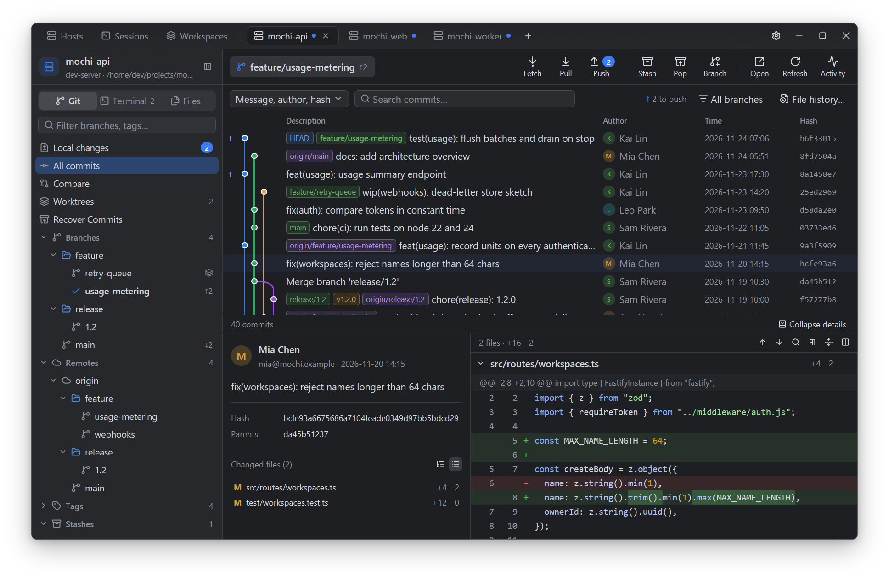
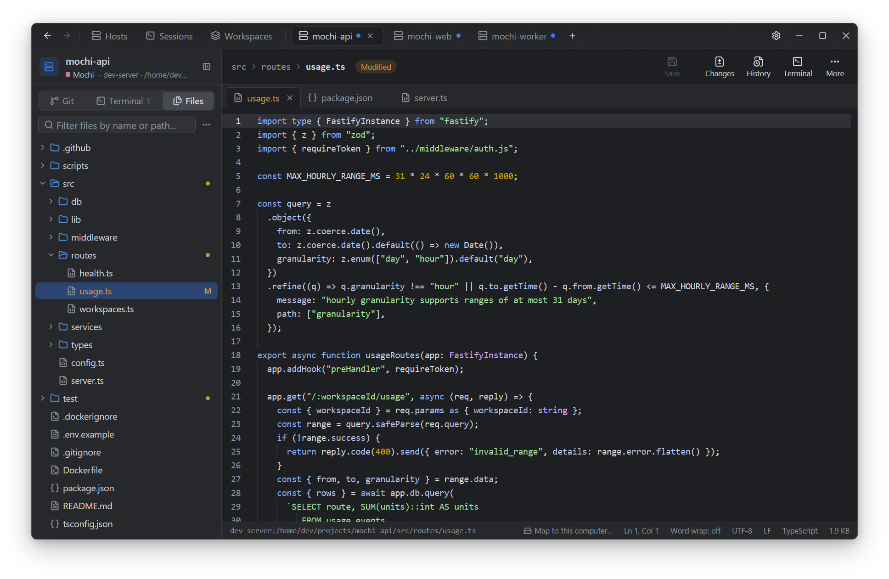
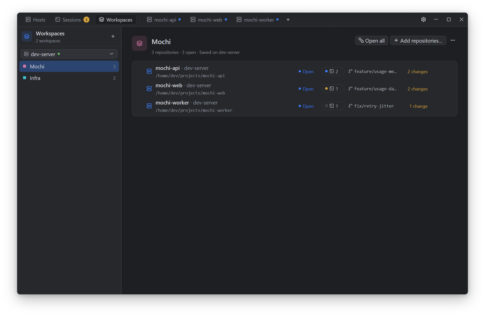
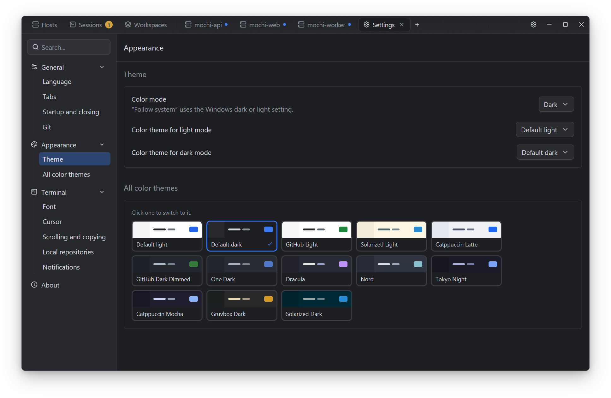
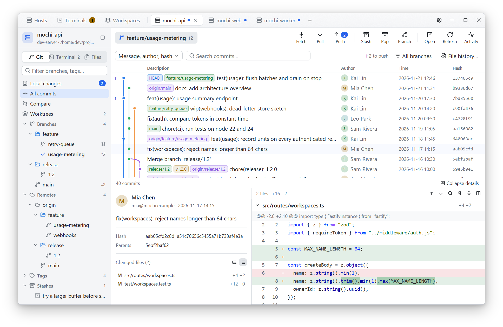
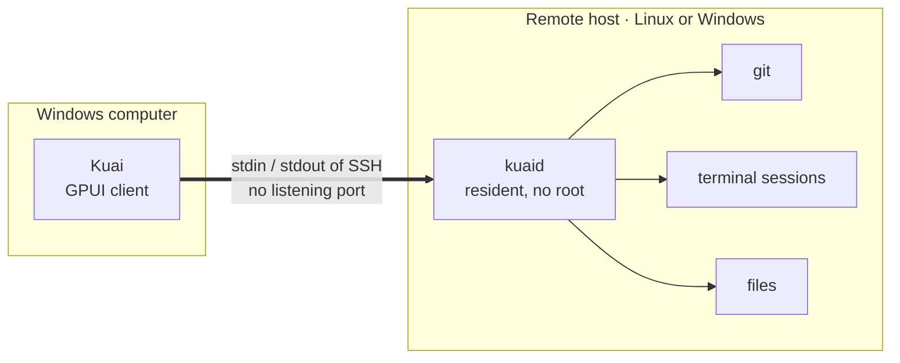

<div align="center">


<h1>Kuai</h1>

<p><b>Remote repositories that feel local.</b></p>

<p>
A remote development client for Windows: Git, terminals and files for repositories on this computer and on remote hosts, in one window.<br>
A Git UI modelled on Fork · terminals that keep running when you disconnect · written in Rust with GPUI
</p>

<p>
<a href="https://github.com/finmoor/kuai/releases/latest"></a>
<a href="https://github.com/finmoor/kuai/actions/workflows/ci.yml"></a>


<a href="#license"></a>
</p>

<p>
<a href="https://github.com/finmoor/kuai/releases/latest"><b>Download</b></a> ·
<a href="#features">Features</a> ·
<a href="#getting-started">Getting started</a> ·
<a href="#how-it-works">How it works</a> ·
<a href="CHANGELOG.md">Changelog</a> ·
<a href="README.md">简体中文</a>
</p>

<picture>
  <source media="(prefers-color-scheme: dark)" srcset="assets/screenshots/en/git-dark.png">
  <source media="(prefers-color-scheme: light)" srcset="assets/screenshots/en/git-light.png">
  
</picture>

<sub>A repository on the remote host dev-server: commit graph, commit details and diff. Projects and people in the screenshots are demo data.</sub>

</div>

## Why Kuai

When you develop on Windows, the code often lives on a Linux host somewhere else. Then:

- graphical Git clients mostly open repositories on the local disk only;
- over SSH you are left with command-line git;
- AI coding assistants such as Claude Code or Codex run on the host, stop when the connection drops, and leave changes that are awkward to review line by line.

Kuai installs a small resident program, `kuaid`, on the host and talks to it over SSH: git runs on the host, terminals run on the host, and Windows only draws the result. The commit graph, line-level staging, conflict resolution, terminals and files of a remote repository work the same way as for a local one.

> The name is the Chinese word for chopsticks (筷子, *kuàizi*): chopsticks instead of a fork. 筷 also sounds like 快, "fast".

## Features

### Git, modelled on Fork

Commit graph, line-level staging, interactive rebase, conflict resolution: everyday Git without leaving the window.


- **Stage and discard by file, hunk or line**; side-by-side view, inline word diff, ignore whitespace, image diff
- **Commit graph**, with branches, remotes, tags and stashes grouped into folders by name; search commits by message, author, hash, file path or changed content
- **Merge, rebase and interactive rebase** (reorder, reword, squash, drop), cherry-pick, revert, reset
- **Conflict resolution**: pick the current version, the incoming one or both for each conflict, or edit by hand
- **Compare** any two branches, tags, commits or the local changes; file history and blame
- **Worktrees, sub-repository overview, submodules**; background auto-fetch; Activity lists every git command that ran, with its output

### Terminals that keep running after you close Kuai

Every repository has its own terminals, running on the host the repository lives on. Close the tab, quit Kuai or lose the network: the programs inside keep running. Open the repository again and you are back where you left, screen contents intact.


- Built for long-running **Claude Code, Codex** and other AI coding assistants: give the task on the Terminal page, then review the changes line by line on the Git page
- **The Terminals page** gathers the terminals of every repository in every workspace; icons tell AI assistants from other commands and idle shells. You are notified when a terminal stops producing output, with a Windows notification when Kuai is in the background
- **Send images and files**: drop them on the terminal, or copy a screenshot and paste. The file is uploaded to the host first, and the terminal receives its path there
- Several terminals per repository; terminals of local repositories also keep running after Kuai quits
- Font, size, line height, cursor and scrollback are configurable

### Files, without setting up SFTP



- **File tree and editor**: view, edit, create, rename, delete, upload and download; images are shown inline
- Reads and writes go through the SSH connection that is already open: **no SFTP to configure**, and it works through jump hosts too
- **Directory mapping**: map a directory on the host to a drive letter or folder on this computer and open it with Explorer, VS Code or any local program (needs [WinFsp](https://winfsp.dev/), which Kuai can install for you)

### Hosts: no root, no open ports

- A host can be **Linux (x86_64)** or a **Windows** computer with the OpenSSH server enabled
- On first connection `kuaid` is installed into the user's home directory (`~/.kuai`): **no root, no listening port**, and the host does not need Internet access
- Uses the OpenSSH client that ships with Windows, along with your `~/.ssh/config`, keys and ssh-agent; passwords and key passphrases are kept in Windows Credential Manager
- Multi-level **jump hosts**; nothing is installed on the jump host
- **Workspaces** group repositories you use together and are stored on the host that holds them: connect from another computer and you see the same list
- A newer Kuai updates `kuaid` on the host when it connects, without interrupting running terminals

### More screens

<table>
  <tr>
    <td width="50%" valign="top"><br><sub><b>Compare</b> · any two branches, tags, commits or the local changes</sub></td>
    <td width="50%" valign="top"><br><sub><b>Workspaces</b> · branches, changes and terminals of a group at a glance</sub></td>
  </tr>
  <tr>
    <td width="50%" valign="top"><br><sub><b>Color themes</b> · 13 of them, one for dark mode and one for light</sub></td>
    <td width="50%" valign="top"><picture><source media="(prefers-color-scheme: dark)" srcset="assets/screenshots/en/git-light.png"><source media="(prefers-color-scheme: light)" srcset="assets/screenshots/en/git-dark.png"></picture><br><sub><b>Light and dark</b> · can follow the system</sub></td>
  </tr>
</table>

Also: Chinese and English UI, system tray and start at sign-in, pinned and reopenable tabs, quick open (Ctrl+P), and one-click updates verified by SHA-256.

## Compared with Fork

Kuai's Git UI follows [Fork](https://fork.dev/) closely, and aims to replace it for everyday use.

- **What Kuai adds**: repositories on remote hosts; built-in terminals that outlive the app; the Files page and directory mapping; a Chinese UI; open source.
- **What is still missing**: reflog, bisect, a dedicated Git LFS UI, git-flow, custom commands, batch operations on several selected commits, and account integration and pull requests for GitHub, GitLab and the like.

## Download

Get it from [GitHub Releases](https://github.com/finmoor/kuai/releases/latest), in either form:

- **Installer** `kuai-<version>-windows-x64-setup.exe` (recommended): installs into your user profile (`%LOCALAPPDATA%\Programs\Kuai`), no administrator rights needed; starts from the Start menu and uninstalls from Settings → Apps.
- **Portable** `kuai-<version>-windows-x64.zip`: unzip the Kuai folder anywhere and run `kuai.exe`.

Requirements:

| Where | What |
|---|---|
| This computer | 64-bit Windows 10 or 11; git 2.31 or newer on PATH; the OpenSSH client that ships with Windows |
| Remote host | Linux (x86_64), or Windows with the OpenSSH server enabled; git 2.31 or newer; no root needed |
| Directory mapping | [WinFsp](https://winfsp.dev/); Kuai offers to install it through winget if it is missing |

The binaries are not code-signed, so on first run Windows may show "Windows protected your PC": choose "More info", then "Run anyway".

When a new version is out, a notice appears left of the gear in the title bar; click it to read the changes and update in one step (the installer build runs the new installer in the background, the portable build replaces its files). You can also check from Settings → About. `kuaid` on your hosts needs no separate update: a newer Kuai replaces it on connection. Release notes are in [CHANGELOG.md](CHANGELOG.md) (in Chinese).

## Getting started

1. Install and open Kuai.
2. On the Hosts page click "Add host…" and enter the address and user name (or a host alias from `~/.ssh/config`), then choose key or password sign-in.
3. On first connection Kuai installs `kuaid` under `~/.kuai` on the host and starts it.
4. Click "Open repository…" and pick the repository's directory on the host.
5. Each repository has three pages, Git, Terminal and Files: run `claude` on the Terminal page, then press <kbd>Ctrl</kbd>+<kbd>&#96;</kbd> to return to the Git page, review the changes, stage by line and commit.

For a repository on this computer: select "This computer" on the Hosts page and click "Add local repository…", or run `kuai.exe <path>` from a command line.

## How it works



- **git runs on the host.** Windows only receives the output and draws it; the code that parses it and lays out the commit graph (`fr-core`) is shared by the client and `kuaid`.
- **`kuaid` is a single statically linked binary** (about 3 MB on Linux), uploaded over SSH into `~/.kuai`. It exits by itself 10 minutes after the last client has disconnected and the last terminal has ended.
- **All traffic goes through the stdin and stdout of SSH**, using the keys and configuration you already have: no new port, no extra account.
- **A native UI.** The client is written in Rust with [GPUI](https://www.gpui.rs/) (via [gpui-kit](https://github.com/longbridge/gpui-kit)) and drawn on the GPU. In the feasibility test, on a repository with 200,000 commits and up to 13 parallel lanes, parsing the history took 79 ms, laying out the lanes 14 ms, and a frame while scrolling 2.7 ms on average.

## Feedback

Found a bug or have a suggestion? Please open an [issue](https://github.com/finmoor/kuai/issues).

## Keyboard shortcuts

The ones you will use most: <kbd>Ctrl</kbd>+<kbd>P</kbd> quick open repository, <kbd>Ctrl</kbd>+<kbd>&#96;</kbd> switch between the Terminal page and the previous page, <kbd>Ctrl</kbd>+<kbd>Shift</kbd>+<kbd>A</kbd> the Terminals page, <kbd>Ctrl</kbd>+<kbd>Enter</kbd> commit, and Space on a changed line to stage it.

<details>
<summary><b>All shortcuts</b></summary>

| Key | Action |
|---|---|
| F5 | Refresh the current repository's status and history |
| Ctrl+Enter | Commit (while focus is in the commit message, the file list or the diff) |
| Ctrl+1, Ctrl+2 | Switch to Local changes / All commits on the Git page and move keyboard focus there |
| Ctrl+F | Find in the current page: search commits on the Git page (or within the diff you are viewing), find in the open file on the Files page, find text in the merge editor |
| Ctrl+P | Quick open repository (Up/Down to select, Enter to open) |
| Ctrl+, | Open or close Settings |
| Ctrl+W | Close the current tab (asks first if an operation is running); on the Files page, closes the open file first |
| Ctrl+Tab, Ctrl+Shift+Tab | Next / previous tab |
| Ctrl+Shift+T | Reopen the most recently closed tab |
| Ctrl+` | Switch to the repository's Terminal page; press again to return to the previous page (Git or Files) |
| Ctrl+Shift+` | Open a new terminal for the current repository and switch to the Terminal page |
| Ctrl+Shift+B | Collapse or expand the sidebar (collapsed, it becomes a strip of icons; shared by all tabs) |
| Ctrl+Shift+E | Switch to the repository's Files page |
| Ctrl+Shift+A | Open the Terminals page (terminals of every repository in every workspace) |
| Ctrl+Shift+↑, Ctrl+Shift+↓ | While typing into a terminal on the Terminals page, switch to the previous / next terminal in the sidebar (a thin line along the top of the terminal shows that it has the input) |
| Alt+← | Inside a sub-repository or a worktree, return to the root repository's overview (not while focus is in a terminal or a text field) |
| Ctrl+S | Save the open file on the Files page |

Keys in lists (click the list first, or move focus there with Ctrl+1 / Ctrl+2):

| Where | Keys |
|---|---|
| File list in Local changes | Up/Down to move, Shift+Up/Down to extend the selection, Ctrl+A to select the whole column; Space or Enter to stage or unstage; Delete to discard (asks first); Right to enter the diff. Ctrl-click and Shift-click also multi-select |
| Diff | Up/Down to move between changed lines, Shift+Up/Down to extend the selection; Space or Enter to stage or unstage the selected lines; Delete to discard them (asks first); Left to return to the file list. In the side-by-side view, drag over the line numbers to select lines; Space and Delete work the same |
| Commit list | Up, Down, PageUp, PageDown, Home, End |
| Sidebar | Up/Down to move, Enter acts as a double-click (switch branch); on a folder, Left collapses and Right expands |
| Blame | Up, Down, PageUp, PageDown, Home, End to select a line; Enter jumps to the commit that changed it; Esc closes |
| File tree on the Files page | Up/Down to move, Left/Right to collapse or expand a folder, Enter to open and keep the file, Space to preview; F2 to rename, Delete to delete (asks first) |

While focus is in a terminal, Kuai handles only these shortcuts: Ctrl+Tab, Ctrl+Shift+Tab, Ctrl+Shift+T, Ctrl+1, Ctrl+2, Ctrl+Shift+E, Ctrl+\`, Ctrl+Shift+\`, Ctrl+,, Ctrl+Shift+B, Ctrl+Shift+A, and Ctrl+Shift+↑ / Ctrl+Shift+↓ on the Terminals page. Every other key (Tab, Shift+Tab, Esc, F5, Ctrl+W, Ctrl+F, Ctrl+P, Ctrl+S, function keys, Alt combinations and so on) goes to the program in the terminal (see below for Alt+V). In a terminal: Ctrl+C interrupts (copies when text is selected), Ctrl+Shift+C copies, Ctrl+V and Shift+Insert paste (an image or a file on the clipboard is pasted as its path); in a terminal on a remote host, Alt+V (the key Claude Code uses on Windows to paste an image) is also sent by Kuai when the clipboard holds an image or a file, exactly like Ctrl+V, and goes to the program otherwise; right-click copies when text is selected and pastes otherwise; Shift+PageUp, Shift+PageDown, the mouse wheel and the scrollbar on the right show earlier output. While you are scrolled back, the input area stays pinned at the bottom, typing does not move the view, and Enter returns to the bottom; the marks on the left are the messages you sent: hover to preview, click to jump. Ctrl+click a URL or a file path to open it: URLs open in the browser, files in the repository open on the Files page at that line, and other files on this computer open in their default program. When the program in the terminal uses the mouse (opencode, or Claude Code in fullscreen mode), clicks, drags, right-clicks and the wheel go to the program; hold Shift to let Kuai handle them instead: drag to select text, right-click to copy or paste, scroll through the terminal's history.

</details>

## Development

You need Rust (stable, MSVC toolchain) and the Visual Studio Build Tools ("Desktop development with C++"). The first build takes about 5 minutes.

```bash
# kuaid for Linux hosts (first: rustup target add x86_64-unknown-linux-musl)
cargo build-kuaid

# the client; give it a directory to open it
cargo run --release -p fr-app -- [directory]

# kuaid for Windows hosts and for local terminals
cargo build --release -p kuaid

# tests
cargo test --workspace

# installer and zip into dist/ (needs Inno Setup 6)
pwsh tools/package.ps1
```

| Path | Contents |
|---|---|
| `crates/fr-core` | Runs git, parses its output, lays out the commit graph; protocol and UI strings. Shared by the client and `kuaid` |
| `crates/fr-channel` | Repository channel: in-process for local repositories, over SSH to `kuaid` for remote ones |
| `crates/fr-app` | The GPUI client |
| `crates/kuaid` | The resident program for Linux and Windows hosts: runs git, hosts terminal sessions |
| `crates/fr-mount` | Maps a directory on a host to a drive letter or folder (WinFsp) |
| `tools/` | Packaging, installer script, UI test scripts |

The "开发" section of the [Chinese README](README.md#开发) has the full notes on building, testing and releasing.

## License

MIT or Apache-2.0, at your option: see [LICENSE-MIT](LICENSE-MIT) and [LICENSE-APACHE](LICENSE-APACHE). The UI icons are [Lucide](https://lucide.dev) (ISC license), brought in by gpui-kit. Third-party libraries and their licenses are listed in `THIRD-PARTY-LICENSES.txt` in the release package.
