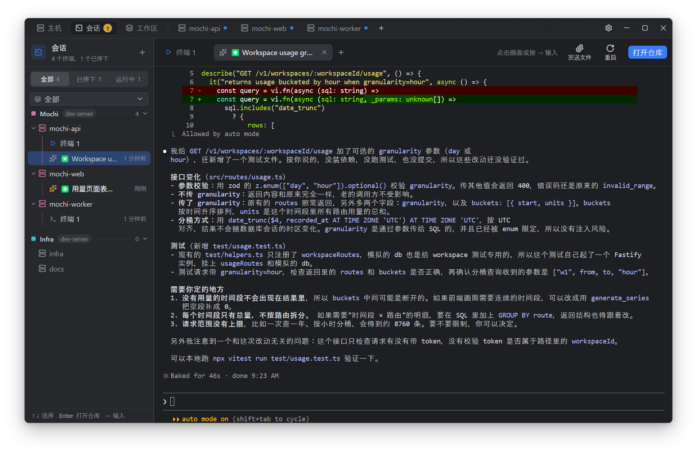
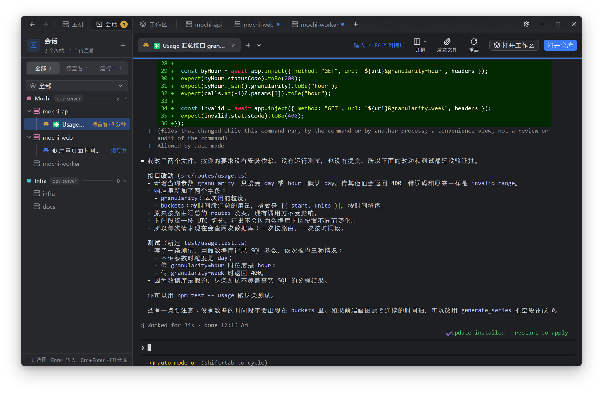
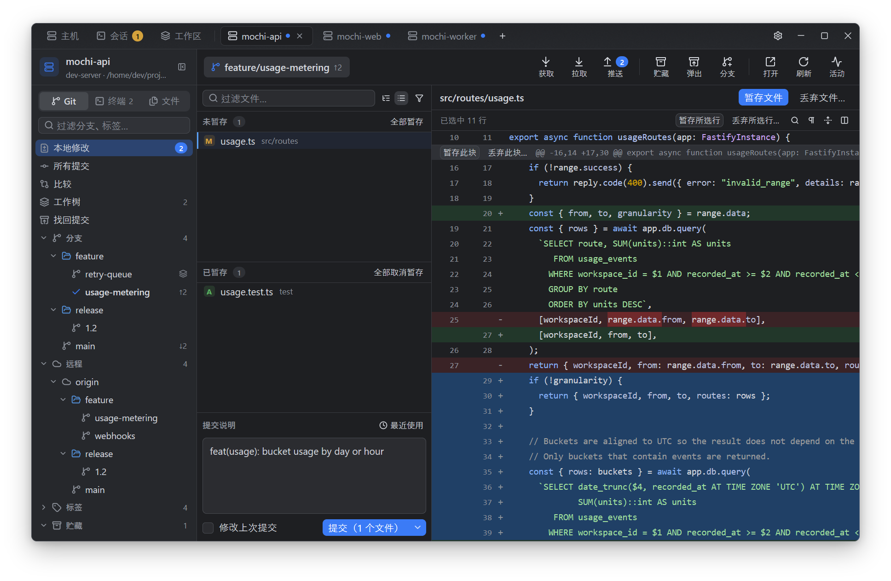
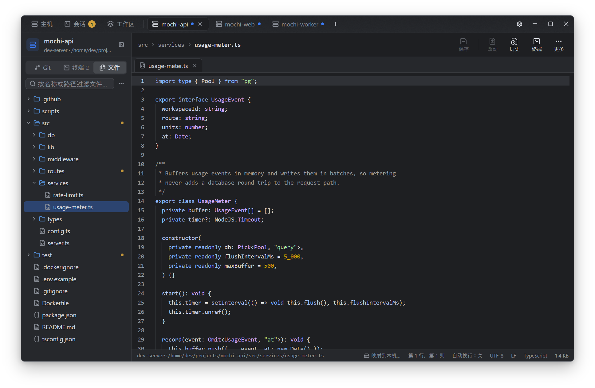
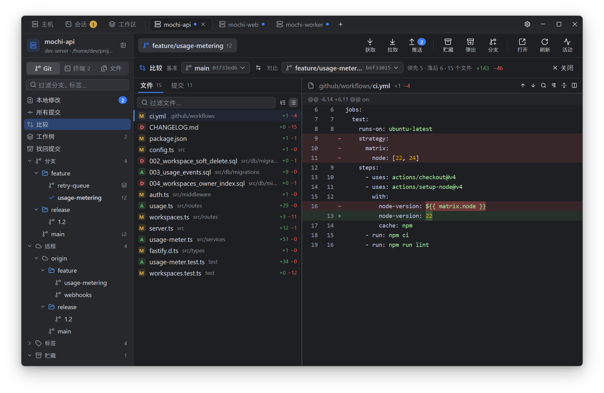
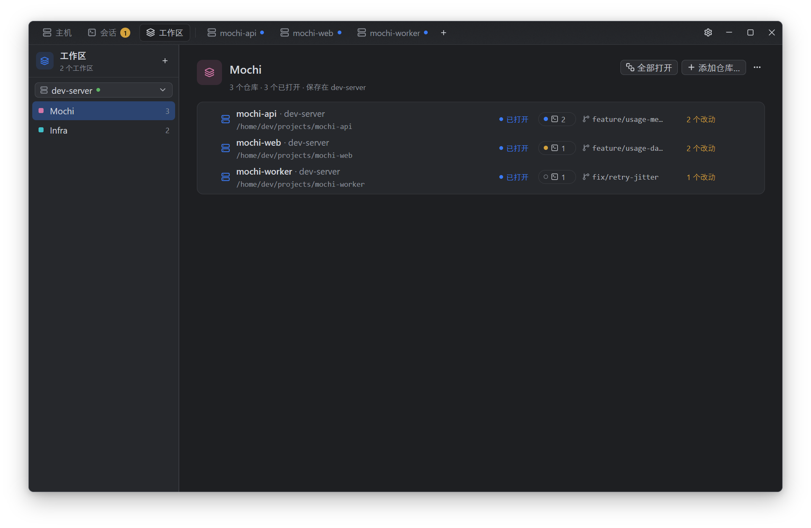
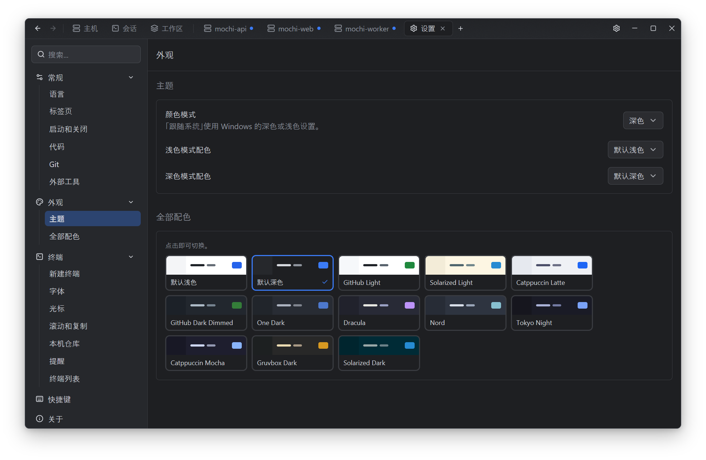
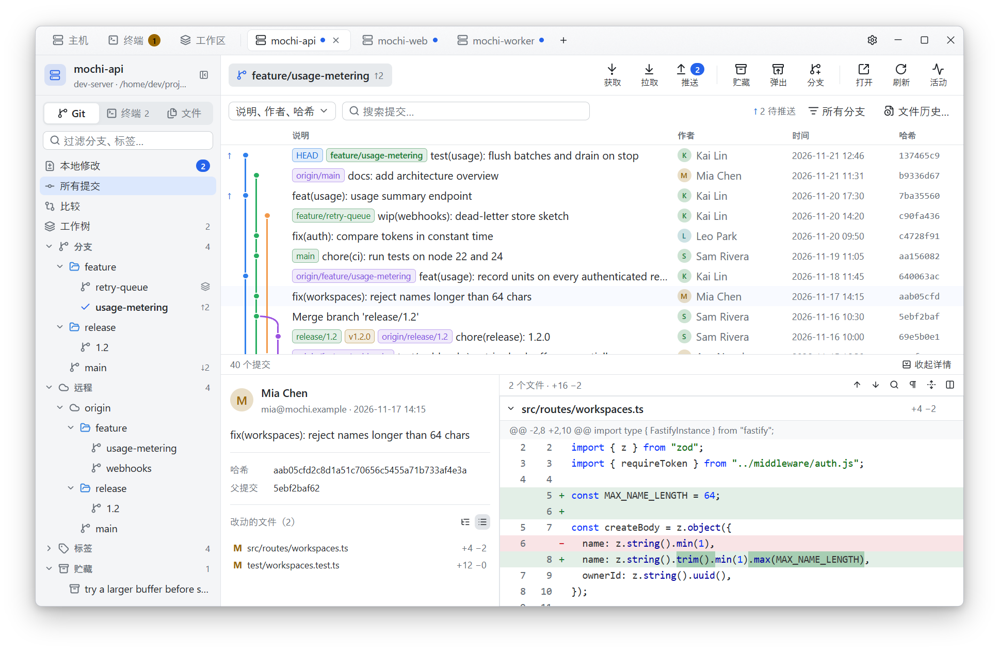
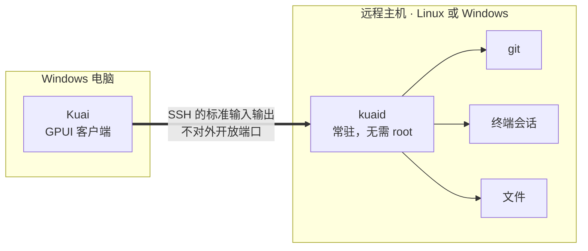

<div align="center">


<h1>Kuai 筷子</h1>

<h3>Claude Code 远程执行，本地开发。</h3>

<p><b>合上电脑，它还在写；打开电脑，逐行验收。</b></p>

<p>
为在 VPS 上运行 Claude Code、Codex 的人而做的 Windows 客户端：<br>
断网不断的终端、逐行审查改动的 Git 界面、直接修改服务器文件的编辑器，合在一个窗口中。
</p>

<p><sub>经 SSH 连接 · 没有中转服务器，没有账号 · 服务器无需 root，不对外开放端口 · 开源</sub></p>

<p>
<a href="https://github.com/finmoor/kuai/releases/latest"></a>
<a href="https://github.com/finmoor/kuai/actions/workflows/ci.yml"></a>


<a href="#许可证"></a>
</p>

<p>
<a href="https://github.com/finmoor/kuai/releases/latest"><b>下载</b></a> ·
<a href="#功能">功能</a> ·
<a href="#快速上手">快速上手</a> ·
<a href="#工作原理">工作原理</a> ·
<a href="#安全">安全</a> ·
<a href="CHANGELOG.md">更新记录</a> ·
<a href="README.en.md">English</a>
</p>



<sub>同一个窗口中的三页：终端、Git、文件，仓库位于远程主机 dev-server。截图中的项目与人名均为演示数据。</sub>

<br><br>

<table>
  <tr>
    <td width="33%" align="center" valign="top"><b>① 跑</b><br><sub>终端常驻在服务器上<br>断网、关窗口、合上电脑都不中断</sub></td>
    <td width="33%" align="center" valign="top"><b>② 审</b><br><sub>并排对比、逐行审查、按行暂存<br>Git 界面向 Fork 看齐</sub></td>
    <td width="33%" align="center" valign="top"><b>③ 改</b><br><sub>目录树和带语法高亮的编辑器<br>也可映射到本机，用 VS Code 打开</sub></td>
  </tr>
</table>

</div>

## 在服务器上运行 Claude Code，本来是这样的

不少人专门买一台 VPS 运行 Claude Code、Codex：任务可以连续运行几个小时，不占用自己的电脑，环境弄乱了可以重装。麻烦在于怎么用它。

| 只有 SSH 的时候 | 用 Kuai |
|---|---|
| SSH 一断，运行到一半的任务随之中断，只能再套一层 tmux | 终端常驻在服务器上：断网、关窗口、合上电脑都不中断，再次打开时画面原样接回 |
| 想给它看一张截图，要先传到服务器，再把路径贴给它 | 截图直接粘贴，文件直接拖进终端，自动上传 |
| 它改了几十个文件，只能在终端里翻 `git diff` | 并排对比逐行审查，要的按行暂存，不要的丢弃 |
| 想修改两行，要么用 vim，要么再配一个远程编辑器 | 文件树和编辑器就在旁边；按住 Ctrl 单击终端里的路径，直接跳到那一行 |
| 同时运行几个任务，不知道哪一个停下来等你确认 | 所有仓库的终端汇总在一页，哪个停下来了会提醒 |
| 换一台电脑，要重新配置一遍 | 工作区保存在服务器上，换一台电脑连接，仓库和终端都在 |

Kuai 在服务器上安装一个常驻的小程序 `kuaid`（约 3 MB，无需 root，不对外开放端口），经 SSH 与它通信：终端在服务器上运行，git 命令在服务器上执行，文件在服务器上读写，Windows 端只负责显示。本机的仓库用法相同。

> 名字取自筷子：不用叉子（Fork）改用筷子，「筷」也谐音「快」。

## 功能

### ① 跑：合上电脑，它还在工作

每个仓库都有自己的终端，运行在仓库所在的主机上。关闭标签页、退出 Kuai、网络断开、合上电脑，其中的 Claude Code 照常运行；再次打开即可接回，屏幕内容保持不变。不需要 tmux。



- **停下来就提醒**：「终端」页汇总所有工作区中各仓库的终端，图标区分 AI 助手、其他命令和空闲的 shell；终端停止输出时提醒，Kuai 不在前台时发送 Windows 通知
- **截图直接发给它**：复制截图后粘贴，或将图片、文件拖进终端；文件自动上传到主机，终端中得到的是它在主机上的路径
- **同时运行多个任务**：一个仓库可以打开多个终端
- 本机仓库的终端同样在退出 Kuai 后继续运行
- 字体、字号、行高、光标、回滚行数均可设置

### ② 审：它改的每一行，都由你过目

完整的图形化 Git 客户端，界面和操作向 Fork 看齐。Claude Code 完成后切换到 Git 页：并排对比逐行查看，要的按行暂存，不要的丢弃，然后提交、推送。



- **按文件、按块、按行**暂存和丢弃；并排对比、行内差异高亮、忽略空白、图片对比
- **提交图**，以及按名称分组的分支、远程、标签和贮藏；可按说明、作者、哈希、文件路径或改动内容搜索提交
- **合并、变基、交互式变基**（调整顺序、修改说明、并入、丢弃）、挑拣、还原、重置
- **冲突解决**：逐处选择当前分支的版本、传入的版本或保留双方，也可手动编辑
- **比较**任意两个分支、标签、提交或本地修改；文件历史、逐行追溯
- **工作树、子仓库总览、子模块**；后台自动获取；「活动」列出执行过的每条 git 命令及其输出
- **找回提交**：列出 HEAD 和各分支移动过的记录，包括 Claude Code 在终端里执行的重置、变基，选中一步即可从那里新建分支；重置、变基、强制推送前写明会影响哪些提交

### ③ 改：服务器上的文件，像本机的一样修改



- **目录树**：新建、重命名、删除、上传、下载；有改动和未跟踪的文件带标记，可按名称过滤
- **编辑器**：行号、语法高亮、查找和替换；保存时若文件已被其他程序修改，会先提示；图片直接显示
- 读写经由已建立的 SSH 连接，**无需另行配置 SFTP**，使用跳板机时同样可用
- **目录映射**：将主机上的目录映射为本机的盘符或文件夹，用资源管理器、VS Code 等本机程序直接打开（需安装 [WinFsp](https://winfsp.dev/)，Kuai 可代为安装）

### 三页互通

终端、Git、文件是同一个仓库的三页，可以直接从一页跳到另一页：

- **终端 → 文件**：按住 <kbd>Ctrl</kbd> 单击终端中的文件路径，在文件页中打开并跳到对应的行
- **文件 → Git**：查看正在编辑的文件的改动，以及改过它的提交
- **Git → 文件**：在改动的文件上点击右键，在文件页中打开
- **文件 → 终端**：在文件所在的目录中新建终端
- <kbd>Ctrl</kbd>+<kbd>&#96;</kbd> 在终端页和之前的页面之间切换，<kbd>Ctrl</kbd>+<kbd>Shift</kbd>+<kbd>E</kbd> 切换到文件页

### 主机：一台普通的 VPS 即可

- 主机可以是 **Linux（x86_64）** 的 VPS、云服务器或开发机，也可以是开启了 OpenSSH 服务的 **Windows** 电脑；暂不支持 ARM
- 首次连接时自动将 `kuaid` 安装到用户目录 `~/.kuai`：**不需要 root 权限，不对外开放端口**，主机也无需联网
- 使用 Windows 自带的 OpenSSH，沿用 `~/.ssh/config`、密钥和 ssh-agent；密码和私钥口令保存在 Windows 凭据管理器中
- 支持多级**跳板机**，跳板机上不安装任何程序
- **工作区**将常一起使用的仓库归为一组，保存在仓库所在的主机上：换一台电脑连接，看到的是同一份
- 新版 Kuai 连接时自动更新主机上的 kuaid，正在运行的终端不受影响

### 更多画面

<table>
  <tr>
    <td width="50%" valign="top"><br><sub><b>比较</b> · 任意两个分支、标签、提交或本地修改</sub></td>
    <td width="50%" valign="top"><br><sub><b>工作区</b> · 一组仓库的分支、改动数和终端状态</sub></td>
  </tr>
  <tr>
    <td width="50%" valign="top"><br><sub><b>配色</b> · 13 套，深色和浅色各选一套</sub></td>
    <td width="50%" valign="top"><br><sub><b>深色与浅色</b> · 可跟随系统</sub></td>
  </tr>
</table>

此外还有：中文和英文界面、托盘和开机自启、可固定和恢复的标签页、快速打开仓库（Ctrl+P），以及带 SHA-256 校验的一键更新。

## 与现有工具相比

**与 [Fork](https://fork.dev/) 相比。** Kuai 的 Git 界面和操作方式向 Fork 看齐，目标是在日常使用中替代它。

- **多出来的**：打开远程主机上的仓库；内置的、退出后继续运行的终端；文件页和目录映射；中文界面；开源。
- **还没有的**：bisect、Git LFS 的专用界面、git-flow、自定义命令、多选提交批量操作，以及 GitHub、GitLab 等平台的账号集成和拉取请求。

**与 IDE 相比。** Kuai 不是 IDE。文件页用于查看和少量修改，没有代码补全、跳转到定义和调试；需要大量编写代码时，可将主机上的目录映射到本机，用 VS Code 等编辑器打开。

## 下载

从 [GitHub Releases](https://github.com/finmoor/kuai/releases/latest) 下载，以下两种任选其一：

- **安装版** `kuai-<版本>-windows-x64-setup.exe`（推荐）：安装在用户目录下（`%LOCALAPPDATA%\Programs\Kuai`），无需管理员权限；可从开始菜单启动，可在「设置 → 应用」中卸载。
- **解压版** `kuai-<版本>-windows-x64.zip`：解压得到的 Kuai 文件夹可放在任意位置，双击 `kuai.exe` 运行。

运行要求：

| 位置 | 要求 |
|---|---|
| 本机 | 64 位 Windows 10 或 11；PATH 中有 git 2.31 或更新的版本；使用 Windows 自带的 OpenSSH |
| 远程主机 | Linux（x86_64，暂不支持 ARM），或开启了 OpenSSH 服务的 Windows；已安装 git 2.31 或更新的版本；无需 root 权限 |
| 目录映射 | 需安装 [WinFsp](https://winfsp.dev/)，未安装时 Kuai 可经 winget 代为安装 |

程序未进行代码签名，首次运行时 Windows 可能提示「Windows 已保护你的电脑」，请点击「更多信息」，再点击「仍要运行」。

有新版本时，标题栏齿轮左侧会显示更新提示，点击可查看更新内容并一键更新（安装版在后台运行新的安装程序，解压版直接替换文件）；也可在「设置 → 关于」中检查更新。主机上的 kuaid 无需单独更新，新版 Kuai 连接时会自动替换。各版本的更新内容见 [CHANGELOG.md](CHANGELOG.md)。

## 快速上手

1. 安装并打开 Kuai。
2. 在「主机」页点击「添加主机…」，填写 VPS 的地址和用户名（也可以填 `~/.ssh/config` 中的主机别名），选择用密钥或密码登录。
3. 首次连接时，Kuai 自动将 kuaid 安装到主机的 `~/.kuai` 下并启动。
4. 点击「打开仓库…」，在主机上选择仓库所在的目录。
5. 每个仓库分为 Git、终端、文件三页：在终端页运行 `claude`，按 <kbd>Ctrl</kbd>+<kbd>&#96;</kbd> 回到 Git 页查看改动、按行暂存、提交。

Claude Code、Codex 需自行在主机上安装并登录，Kuai 不代为安装。

打开本机的仓库：在「主机」页选中「本机」，点击「添加本机仓库…」；或在命令行中运行 `kuai.exe <仓库路径>`。

## 工作原理



- **git 在主机上执行。** Windows 端只接收结果并负责显示；解析输出、计算提交图布局的代码（`fr-core`）由客户端和 kuaid 共用。
- **kuaid 是一个静态链接的单文件程序**（Linux 版约 3 MB），经 SSH 上传到 `~/.kuai` 下。所有客户端断开且终端全部结束 10 分钟后，它自动退出。
- **通信只经过 SSH 的标准输入输出**，沿用系统已有的密钥和配置，不需要在防火墙上另开端口，也不需要额外的账号。
- **原生界面。** 客户端使用 Rust 和 [GPUI](https://www.gpui.rs/)（经 [gpui-kit](https://github.com/longbridge/gpui-kit) 引入）编写，由显卡绘制。技术验证时，在 20 万个提交、13 条并行泳道的测试仓库上，解析历史用时 79 ms，计算泳道布局用时 14 ms，滚动时每帧绘制平均 2.7 ms。

## 安全

Kuai 不自建连接和认证，全部交给 SSH。思路与 VS Code 的 Remote - SSH 相近：经 SSH 登录，在用户目录中安装一个服务端程序。

- **连接即 SSH。** 使用 Windows 自带的 OpenSSH 客户端，认证和加密由它完成，沿用 `~/.ssh/config`、密钥和 ssh-agent。Kuai 与 kuaid 之间的全部数据，都经这条 SSH 连接的标准输入输出传输。
- **没有中转服务器，没有账号。** 数据只在电脑和主机之间传输，不经过第三方服务器。Kuai 不收集使用数据；除 SSH 连接和 git 自身的操作外，它只向 GitHub 检查和下载更新，可在设置中关闭。
- **主机上不需要 root，不对外开放端口。** kuaid 安装在用户目录中，以登录用户的身份运行，权限不超过该用户经 SSH 登录后原有的权限。Linux 主机上它不监听任何端口，只使用 `~/.kuai/run` 中的 Unix 套接字，目录和套接字仅本人可访问；Windows 主机上它只监听 127.0.0.1 的一个随机端口，连接时须提供保存在用户目录中的随机口令。
- **主机密钥。** 首次连接一台主机时，Kuai 显示其密钥指纹，确认后才记入 `known_hosts` 并继续连接；此后密钥发生变化，Kuai 拒绝连接。指纹可在主机上用 `ssh-keygen -lf /etc/ssh/ssh_host_ed25519_key.pub` 查看（文件名随密钥类型而定）。
- **密码和私钥口令**保存在 Windows 凭据管理器中，不写入设置文件，不出现在命令行和日志中。ssh-agent 转发默认关闭，可按主机开启。
- **更新。** 新版本从 GitHub Releases 下载，安装前核对 SHA-256，核对不通过不安装。主机上的 kuaid 随客户端一同发布，经 SSH 上传，主机无需联网下载。安装包目前没有代码签名。
- **开源。** 客户端和 kuaid 的源码都在本仓库中，可自行审阅和构建。

需要留意：Kuai 不限制终端中程序的行为。Claude Code 等程序在主机上拥有登录用户的全部权限，这一点与经 SSH 直接运行它们相同。

发现安全问题，请经本仓库 Security 页的 [Report a vulnerability](https://github.com/finmoor/kuai/security/advisories/new) 私下报告，不要公开提 Issue。

## 反馈

发现问题或有建议，请在 [Issues](https://github.com/finmoor/kuai/issues) 中提出。

## 快捷键

常用的几个：<kbd>Ctrl</kbd>+<kbd>P</kbd> 快速打开仓库，<kbd>Ctrl</kbd>+<kbd>&#96;</kbd> 在终端页和之前的页面之间切换，<kbd>Ctrl</kbd>+<kbd>Shift</kbd>+<kbd>A</kbd> 打开「终端」页，<kbd>Ctrl</kbd>+<kbd>Enter</kbd> 提交，在改动行上按空格键暂存。

<details>
<summary><b>全部快捷键</b></summary>

| 按键 | 作用 |
|---|---|
| F5 | 刷新当前仓库的状态和提交历史 |
| Ctrl+Enter | 提交（焦点位于提交说明框、文件列表或改动内容中时均可） |
| Ctrl+1、Ctrl+2 | 切换到 Git 页的本地修改、所有提交，并将键盘焦点移到该处 |
| Ctrl+F | 在当前页中查找：Git 页中搜索提交（正在看改动时在改动中搜索），文件页中查找打开的文件，合并编辑器中查找文本 |
| Ctrl+P | 快速打开仓库（上下方向键选择，Enter 打开） |
| Ctrl+, | 打开或关闭设置页 |
| Ctrl+W | 关闭当前标签页（有操作正在执行时会先提示）；在文件页中先关闭当前打开的文件 |
| Ctrl+Tab、Ctrl+Shift+Tab | 切换到下一个、上一个标签页 |
| Ctrl+Shift+T | 重新打开最近关闭的标签页 |
| Ctrl+` | 切换到当前仓库的终端页；已在终端页时回到之前的那一页（Git 页或文件页） |
| Ctrl+Shift+` | 为当前仓库新建终端，并切换到终端页 |
| Ctrl+Shift+B | 收起或展开左侧栏（收起后显示为一列图标，所有标签页共用此状态） |
| Ctrl+Shift+E | 切换到当前仓库的文件页 |
| Ctrl+Shift+A | 切换到「终端」页（所有工作区中各仓库的终端） |
| Ctrl+Shift+↑、Ctrl+Shift+↓ | 在「终端」页往终端中输入时，切换到侧栏中的上一个、下一个终端（输入时终端画面顶上有一条细线） |
| Alt+← | 在子仓库或工作树中时，返回根仓库的子仓库总览或工作树总览（焦点在终端、输入框中时不生效） |
| Ctrl+S | 保存文件页中当前打开的文件 |

列表中的按键（先点击列表，或用 Ctrl+1、Ctrl+2 将焦点移到列表）：

| 位置 | 按键 |
|---|---|
| 本地修改的文件列表 | 上下方向键切换文件，Shift+上下方向键连续选择，Ctrl+A 全选该栏；空格键或 Enter 暂存、取消暂存；Delete 丢弃（会先确认）；右方向键进入改动内容。按住 Ctrl 或 Shift 点击也可多选 |
| 改动内容 | 上下方向键在改动行之间移动，Shift+上下方向键连续选择；空格键或 Enter 暂存、取消暂存所选行；Delete 丢弃所选行（会先确认）；左方向键返回文件列表。并排显示时改为在行号上拖动以选择行，空格键和 Delete 的作用不变 |
| 提交列表 | 上下键、PageUp、PageDown、Home、End |
| 侧栏 | 上下方向键切换选中项，Enter 相当于双击（切换分支）；选中文件夹时左方向键折叠、右方向键展开 |
| 逐行追溯 | 上下方向键、PageUp、PageDown、Home、End 选择行，Enter 跳转到修改该行的提交，Esc 关闭 |
| 文件页的目录树 | 上下方向键切换，左右方向键折叠、展开目录，Enter 打开文件并保留，空格键预览；F2 重命名，Delete 删除（会先确认） |

焦点位于终端中时，只有以下快捷键仍由 Kuai 处理：Ctrl+Tab、Ctrl+Shift+Tab、Ctrl+Shift+T、Ctrl+1、Ctrl+2、Ctrl+Shift+E、Ctrl+\`、Ctrl+Shift+\`、Ctrl+,、Ctrl+Shift+B、Ctrl+Shift+A，以及「终端」页中的 Ctrl+Shift+↑、Ctrl+Shift+↓。其余按键（Tab、Shift+Tab、Esc、F5、Ctrl+W、Ctrl+F、Ctrl+P、Ctrl+S、功能键、Alt 组合键等）交给终端中的程序（Alt+V 见下文）。终端中：Ctrl+C 中断（选中文字时为复制），Ctrl+Shift+C 复制，Ctrl+V、Shift+Insert 粘贴（剪贴板中为图片或文件时，粘贴的是其路径）；远程主机上的终端中，剪贴板中有图片或文件时 Alt+V（Claude Code 在 Windows 上粘贴图片的按键）也由 Kuai 发送，与 Ctrl+V 相同，否则交给程序；右键在有选中文字时复制，否则粘贴；Shift+PageUp、Shift+PageDown、鼠标滚轮和右侧的滚动条可查看之前的输出，往回翻时输入区固定在底部，打字时画面不动，按 Enter 回到底部；左侧的刻度是发出过的消息，鼠标停留可预览，单击跳转；按住 Ctrl 单击网址、文件路径即可打开：网址在浏览器中打开，仓库中的文件在文件页中打开并跳到对应的行，本机上仓库外的文件用默认程序打开。终端中的程序使用鼠标时（例如 opencode、全屏模式的 Claude Code），点击、拖动、右键和滚轮都交给程序；按住 Shift 时仍由 Kuai 处理：拖动选中文字，右键复制或粘贴，滚动查看终端的记录。

</details>

## 开发

需要 Rust（stable，MSVC 工具链）和 Visual Studio 生成工具；`cargo run --release -p fr-app` 即可运行客户端。

<details>
<summary><b>技术栈、目录结构、构建与发版</b></summary>

### 技术栈

- 客户端：Rust + GPUI，经 [gpui-kit](https://github.com/longbridge/gpui-kit) 0.9 引入（gpui-pre 快照、gpui-base、gpui-component）。
- 主机上的 `kuaid`：Rust；Linux 版用 musl 静态编译，从 Windows 交叉编译；Windows 版（1.11 起）和客户端一起编。1.5 以前叫 fr-agent，那时不常驻。
- 本机仓库在进程内直接调用核心代码；远程主机上的仓库经 SSH 交给 kuaid。两边用同一套 `fr-core`。本机仓库的终端（1.11 起）开在这台电脑自己的 kuaid 里。
- git 操作调用命令行，密码输入走 askpass 助手，和 Fork 的做法一样；高频只读操作以后可以换成 gitoxide。
- 选这套栈是为了性能。GPUI 还没到 1.0，动手前先做了技术验证（大提交图滚动、大 diff 高亮、中文输入法、kuaid 经 SSH 往返），都通过了。

### 目录

| 路径 | 内容 |
|---|---|
| `crates/fr-core` | 调用 git、解析输出、计算提交图布局、通信协议、界面语言（`i18n.rs`，英文译文在 `locales/en.json`）；不依赖界面，客户端和 kuaid 共用 |
| `crates/fr-channel` | 仓库通道：本机仓库在进程内执行 git，远程主机上的仓库经 ssh 交给 kuaid（连接复用、自动安装 kuaid、终端接口）；测试工具 `fr-probe` |
| `crates/fr-app` | GPUI 客户端 |
| `crates/kuaid` | 常驻程序 `kuaid`（Linux、Windows）：执行 git、托管终端会话；装在主机上，Windows 电脑自己也用它开终端 |
| `crates/fr-mount` | 把主机上的目录映射成本机的盘符或文件夹：WinFsp 的薄绑定（运行时加载它的 DLL）和文件系统，读写变成 kuaid 的 `fs_*` 请求 |
| `tools/gen-test-repo.py` | 生成性能测试用的大仓库 |
| `tools/ui-test/` | 界面测试脚本：建测试仓库、截窗口、往测试窗口投递点击和输入（不动真实鼠标） |
| `tools/package.ps1` | 打发布包：客户端加 Linux 版、Windows 版 kuaid，出安装程序和解压版的 zip，输出到 `dist/` |
| `tools/package-linux.sh` | 打 Linux 版的发布包（tar.gz）：Linux 客户端加 Windows 版的包里那一批 kuaid |
| `tools/installer/` | 安装程序的脚本（Inno Setup 6，`kuai.iss`）和简体中文的界面文字 |
| `tools/release-notes.ps1`、`CHANGELOG.md` | 发版时的发布说明：取 `CHANGELOG.md` 里这个版本的那一节 |
| `.github/workflows/` | 推代码时在 Windows、Linux 上各跑一遍全部测试（`ci.yml`）；推 `v*` 标签时打包发版（`release.yml`：先打 Windows 版，Linux 版用它的 kuaid，都打好了再建 Release） |
| `tools/make-icon.py` | 画应用图标，输出 `crates/fr-app/assets/icon.ico` |

### 构建与运行

需要 Rust（stable，MSVC 工具链）和 Visual Studio 生成工具（「使用 C++ 的桌面开发」：MSVC 和 Windows SDK）。第一次编译约 5 分钟。

Linux 客户端在 Linux 上编，要先装 GPUI 的开发包（Ubuntu、Debian 上的包名见 `.github/workflows/ci.yml`），命令和下面一样（程序是 `target/release/fr-app`）。发布的 Linux 版在 Ubuntu 22.04 上编，要 glibc 2.35 及以上。

```bash
# Linux 版 kuaid：连主机时客户端从 target/x86_64-unknown-linux-musl/release/ 取它上传
# （先 rustup target add x86_64-unknown-linux-musl）
cargo build-kuaid

# 客户端；给了目录就打开（不是仓库先问是否初始化）。同一个设置文件只运行一个 Kuai，
# 已经在运行时交给运行着的那个，测试时用 FR_SETTINGS 换一个设置文件
cargo run --release -p fr-app -- [目录]

# 测通道：本机仓库，或者主机上的仓库（需要时自动上传 kuaid）
cargo run --release -p fr-channel --bin fr-probe -- --repo .testdata/big-repo local
MSYS_NO_PATHCONV=1 cargo run --release -p fr-channel --bin fr-probe -- --repo <主机上的仓库路径> <ssh 目标>

# 测主机上的终端：开（或者接上）这个仓库的终端敲一条命令、列出终端会话、结束它
cargo run --release -p fr-channel --bin fr-probe -- --repo <主机上的仓库路径> <ssh 目标> --term "echo hi"
cargo run --release -p fr-channel --bin fr-probe -- --repo <主机上的仓库路径> <ssh 目标> --term-list

# 单元测试
cargo test --workspace

# kuaid 常驻那一套（拉起、终端断开后还在、升级不断终端）两个系统各有一份实现、各测各的。
# Windows 版：上面的 cargo test --workspace 里就有（crates/kuaid/tests/windows.rs，拿真的 kuaid.exe 测）。
# Linux 版：交叉编译出测试程序，连同 kuaid 拷到 Linux 机器上跑，见 crates/kuaid/tests/linux.rs 开头；
# 在 Linux 上直接 cargo test --workspace 也行（ci.yml 就是这样）
cargo test --no-run --release -p kuaid --target x86_64-unknown-linux-musl

# Windows 版 kuaid：连 Windows 主机、开本机终端时，客户端从自己旁边（target/release/kuaid.exe）取它
cargo build --release -p kuaid

# 打发布包：dist/kuai-<版本>-windows-x64-setup.exe（安装程序）和 dist/kuai-<版本>-windows-x64.zip
# （解压出来是一个 Kuai 文件夹）。要 Inno Setup 6（winget install JRSoftware.InnoSetup --scope user）；
# 包里的第三方库许可证清单由 tools/third-party-licenses.py 生成，要 Python 3
pwsh tools/package.ps1
```

发版：改 `Cargo.toml` 的版本号，在 `CHANGELOG.md` 加上这个版本的一节（每条一句话，会显示在 Kuai 的更新提示中），提交后打标签 `v<版本>` 推上去，`release.yml` 测试、打包、建 GitHub Release。Kuai 检查更新时只认 `kuai-*-windows-x64-setup.exe`（安装版用）和 `kuai-*-windows-x64.zip`（解压版用）这两个附件。

设置存在 `%APPDATA%\kuai\settings.json`；环境变量 `FR_SETTINGS` 可以换成别的文件，测试时不碰自己的设置（开机自启写的是注册表，测试时用 `FR_AUTOSTART_KEY` 换一个键，任务管理器里的「禁用」记在它后面加 `-approved` 的键里）。

界面上新加一句话：源码里直接写中文、包上 `tr("…")`（带变量用 `tf!`），再到 `crates/fr-core/locales/en.json` 里补英文；没补的话 `cargo test -p fr-core` 会把缺的列出来。在 Git Bash 里给 Windows 程序传 `/data/...` 这类路径会被改写，所以上面测主机那条要加 `MSYS_NO_PATHCONV=1`。

</details>

## 许可证

MIT 或 Apache-2.0，任选其一，见 [LICENSE-MIT](LICENSE-MIT)、[LICENSE-APACHE](LICENSE-APACHE)。界面图标是 [Lucide](https://lucide.dev)（ISC 许可），经 gpui-kit 带进来。用到的第三方库和它们的许可证在发布包的 `THIRD-PARTY-LICENSES.txt` 里。

Claude Code、Codex、Fork、VS Code 等名称归各自的所有者所有，Kuai 与它们没有隶属关系。
